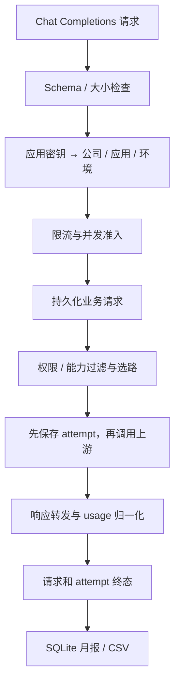

# 仓库开发与维护指南

[返回项目首页](../README.md) · [API 参考](api-reference.md) · [部署运维](../deploy/README.md) · [历史设计](../specs/local-mvp/design.md)

面向直接修改 pp-router 的开发者。套件调用方请先看 [接入指南](integration.md)，不需要为了使用模型而部署一份网关。

## 本地开发

支持 macOS / Linux，Python 3.12 或 3.13、uv、Node.js 22.12+、npm。后端使用 `fcntl` 文件锁，不是未经适配就能直接运行在 Windows 的工程。

```sh
make setup
make init
make dev
```

`setup` 安装锁定依赖，缺失时创建 `0600` 的 `.env`，安装前端依赖与 Chromium；不覆盖已有 `.env`。`init` 迁移数据库并生成初始管理员、`pp_admin` 演示公司、PP Code / PP Chat / PP CAD 三个产品应用及授权、密钥和内部开户凭证。三个应用初始均授权全部模型；输出上限统一为 32000，模型总上下文上限统一为 256000。默认本地密码随机生成，也可提前在 `.env` 设置至少 12 字符的 `PP_ADMIN_PASSWORD`。既有应用的迁移与接入说明见 [应用目录](applications.md)。

PP Code 客户端开发在独立的 [pp-code 仓库](https://github.com/Principle-of-Procrastination/pp-code)进行，源码启动和模型连接实现见其 [开发者指南](https://github.com/Principle-of-Procrastination/pp-code/blob/main/pp/DEVELOPMENT.md)。跨仓库修改调用协议或限制时，需同时核对客户端配置、构建产物和网关接口；对应文件入口见 [PP Code 接入说明](applications.md#pp-code-的已有接入)。

首次凭证写入 `.local/credentials.json`。重复初始化不会重置密码或重新导出已存在的密钥。新数据库应使用新的、可写且未占用的凭证输出路径；不要删数据库后继续把旧凭证文件当成新环境凭证。初始化如果在写凭证文件时失败，要先核查数据库是否已初始化，不要假定再次运行可以取回明文。

管理端为 `http://127.0.0.1:5173`，后端为 `http://127.0.0.1:4000`，Swagger 为 `/docs`。`make dev` 启动两个进程，Ctrl+C 会回收其进程组。若需要分别启动：

```sh
uv run uvicorn pprouter.main:app --host 127.0.0.1 --port 4000 --no-access-log
# 另一个终端，在仓库根目录执行：
npm run dev --prefix frontend -- --host 127.0.0.1 --strictPort
```

没有上游 API Key 可以登录后台；真实业务请求会因无可用模型而拒绝，不会伪装成模拟回答。测试替身仅在测试入口注入。

## 配置

设置由 `Settings.from_env()` 加载，先读取项目根目录 `.env`，已经存在的进程环境变量优先。Docker 将受保护文件只读挂载到 `/app/.env`，不会把模型密钥放进镜像或 Compose 的容器环境元数据。

| 变量 | 默认 / 用途 |
|---|---|
| `DEEPSEEK_API_KEY` | 空；DeepSeek 官方凭证 |
| `MOONSHOT_API_KEY` | 空；Kimi 官方凭证 |
| `PP_ADMIN_PASSWORD` | 只用于首次创建管理员；不会修改已有管理员密码 |
| `PPROUTER_DATABASE_PATH` | `data/pprouter.db`；相对路径按项目根目录解释 |
| `PPROUTER_ALLOWED_ORIGINS` | 本地 localhost / 127.0.0.1 的 5173、4000；多个精确 Origin 用逗号分隔，不允许 `*` |
| `PPROUTER_TIMEOUT_SECONDS` | 180；执行调用超时设置，必须大于 0 |
| `PPROUTER_ROUTER_TIMEOUT_SECONDS` | 5；分类超时设置，必须大于 0 |
| `PPROUTER_MAX_CONCURRENT` | 16；整个后端进程的模型请求并发保护 |
| `PPROUTER_COOKIE_SECURE` | 本地 false；HTTPS 部署设为 true |

`session_seconds=8小时`、`max_body_bytes=20MiB` 当前为代码设置，未开放同名环境变量。`pprouter/limits.py` 定义网关上下文 256000 / 输出 32000 的上限，数据库模型和授权还可约束更低值。请求输出必须满足所有上限，超限拒绝，不自动改写为更小值；不传时默认使用授权上限（初始为 32000），低消耗测试仍应显式设为 32 或 256。

上下文检查使用输入 UTF-8 字节、消息 / 工具 / 格式开销及每张图片 80000 的保护性预算，加上有效输出上限，再与 256000 及模型上限比较。它不是供应商精确 tokenizer，可能比真实容量更早拒绝，不能用于填充用量。不会自动裁剪业务输入；`GET /v1/models` 返回当前密钥可用的 `context_tokens` / `max_output_tokens` 扩展字段。

供应商地址固定在 `providers.py`：DeepSeek 为 `https://api.deepseek.com`，Kimi 为 `https://api.moonshot.cn/v1`。请求方不能覆盖它们，也不能携带自己的供应商凭证。修改进程环境或配置文件后需重启后端；服务器替换挂载文件时使用容器重建，见 [运维手册](../deploy/README.md)。

## 架构与代码入口



| 文件 / 目录 | 责任 |
|---|---|
| `pprouter/main.py` | 应用生命周期、数据库锁、迁移 / 恢复、公共模型接口、中间件和异常响应 |
| `pprouter/security.py` | 密钥解析、管理员会话 / CSRF、密码哈希、进程内准入和释放 |
| `pprouter/admin.py` | 公司、应用、授权、密钥、内部开户、管理调试与路由预览 |
| `pprouter/schemas.py` | 明确的 Chat Completions 子集、图片 / 工具 / JSON Schema 验证 |
| `pprouter/routing.py` | 候选过滤、工具绑定选择、受限分类、降级与策略快照 |
| `pprouter/providers.py` | 官方 SDK 客户端、模式差异、错误分类、usage 归一化 |
| `pprouter/gateway.py` | 普通与流式执行、有限重试、断线取消、终态和资源释放 |
| `pprouter/records.py` | 请求 / attempt 写入、幂等终态、工具绑定、上海月份 |
| `pprouter/models.py` / `db.py` | SQLAlchemy 数据模型、会话、迁移与中断恢复 |
| `pprouter/catalog.py` / `bootstrap.py` | 初始模型与策略、幂等演示环境初始化 |
| `pprouter/reports.py` | 月报约束、去重统计、分组和 CSV |
| `frontend/src/App.tsx` / `api.ts` | 四个管理页面、同源认证、SSE 消费与调试 |
| `migrations/` | Alembic 迁移，SQLite batch 模式 |
| `scripts/` | 本地启动、显式真实验收、发布包与测试入口 |
| `tests/` / `frontend/e2e/` | 模拟协议、隔离、并发、计量及浏览器测试 |
| `deploy/` | Docker Compose、Nginx、证书续期、运维说明 |
| `docs/examples/` | 给其他套件的独立调用示例 |

## 身份和数据库边界

核心关系是 `Company → CompanyApplication ← Application`，应用目录为共享目录。应用密钥绑定授权和环境；管理员是独立实体，不能从公司名称推导权限。

| 数据组 | 关键约束 |
|---|---|
| `companies` | code 唯一，非空 external_id 唯一，用于幂等开户 |
| `applications` | 全局应用目录，code 唯一，停用会影响所有客户 |
| `company_applications` | company_id + application_id 唯一；模型权限、限制、策略及版本在这一层 |
| `access_keys` | application 必须绑定 grant；provisioning 不能绑定 grant；只存哈希和前缀 |
| `admin_users` / `admin_sessions` | Argon2 密码哈希；服务端会话 token 哈希与 CSRF token |
| `requests` | 一次业务请求的身份、时间、状态与选路信息，不保存对话正文 |
| `attempts` | request_id + ordinal 唯一；routing 与 completion 分别入账 |
| `tool_bindings` | grant_id + environment + tool_call_id 唯一；绑定模型及模式 |
| `models` / `audit_logs` | 模型能力与启停，管理动作与必要诊断 |

公司创建和授权创建使用 SQLite `ON CONFLICT DO NOTHING` 处理并发幂等。密钥签发不是幂等操作；不要把公司的去重逻辑套到发钥上。内部开户凭证目前权限较大，没有细粒度角色隔离。

## 修改代码时必须保持的行为

1. **身份来源固定。** 公司、应用、环境从已验证密钥推导。请求体或请求头不能越过它；管理员调试也以选定应用身份经过正常调用链路。
2. **外发前先持久化。** 请求及每次 attempt 必须先落库。存储不可写时不能发新上游请求；失败、取消、超时都要保留终态。
3. **确认用量不估算。** 核心 usage 必须有效且 input + output = total。缺失或异常标记未知；明细保留 null，不用本地 token 估算填充计量。
4. **每次 attempt 只写入一次终态。** 流式 usage 可随最后一个非空 chunk 返回，也可能重复；终态写入幂等。图片、缓存、推理子项不再次累加。
5. **释放覆盖全部退出路径。** 客户断线、生成器关闭、超时和存储异常不能泄漏上游流、pending task 或并发许可。终态与释放逻辑在取消保护区内执行。
6. **路由不能越权。** 分类结果只能在程序给出的候选集中选择。无候选必须失败；不能移除请求能力来凑候选。
7. **重试可解释。** SDK max_retries=0；最多增加一次明确可安全重试的执行尝试。未知超时和流开始输出后不自动重放。
8. **不持久化正文。** 请求、回复、推理、图片及图片 URL 不进入网关日志 / 数据库；原始 usage 只保留白名单中的数值字段。不要在错误处理里回显整个输入或上游响应。

## 路由与供应商适配

显式模型、唯一候选和已绑定的工具续接不会增加分类。多候选 auto 默认调用 DeepSeek Flash，非思考模式、256 输出 token、默认 5 秒超时；分类输入总上限 8000 字符，包含应用说明、任务文字和图片 / 工具特征，不包含图片内容和 URL。

分类 schema 固定六种任务和六种原因码，并再次检查 model 是否属于候选。策略中的 task_routes 是分类偏好，不是分类器可绕过的权限规则；`needs_reasoning` 是决策信息，不直接改写调用者的推理参数。模型模式由 `mode_for()` 决定，并在工具绑定中保留。

默认策略有两个入口：bootstrap 采用 `catalog.DEFAULT_POLICY`，普通创建授权使用 `admin.Policy` 的默认值。当前两处的 fallback 顺序不同；新增或调整默认行为时需一起检查，已有数据库记录不会自动跟随代码常量变化。

扩展模型 / 供应商不能只往数据库插入一行：需要同时检查 `MODEL_IDS`、Policy 的 Literal / 列表上限、`ProviderPool`、能力和模式过滤、usage / 错误映射、前端固定模型目录、初始化 / 迁移及接入文档。现有 Model 管理 API 只支持启停，不能动态修改供应商地址或能力。`initialize()` 只补缺失模型，不覆盖已存在模型的能力字段。

测试新增模式时至少覆盖：显式与 auto、图片 / Schema 不兼容、工具原样续接、两种流式 usage 形态、未知用量、超时和取消、权限拒绝，以及重试前后模型与用量归属。

## 数据库与迁移

SQLite 开启 WAL、外键与 5 秒 busy timeout，写事务保持短小。每个数据库只允许一个运行中的后端进程；启动时取得文件锁，再迁移并将残留 running 记录改为 interrupted，不自动补发请求。锁文件存在本身不代表锁仍被持有，不要靠删除锁文件绕过运行实例。

后端启动和 CLI migrate 会应用当前迁移。模型字段变更需要提交 Alembic revision，不能靠删除真实数据库更新结构。

`6b5d9182c4fa` 原地更新产品目录，`c7218f4b0ad6` 统一已有模型和授权的 token 上限；后者为改变的授权递增策略版本并记录前后值。迁移不重新发钥、不改变管理员身份或历史用量。回退上限迁移仅允许记录仍与迁移后的值一致；之后又编辑了授权时会拒绝覆盖，应使用核对过的备份进行恢复。

下面的例子显式使用独立的开发数据库；不会调用模型：

```python
from pathlib import Path
from alembic import command
from alembic.config import Config

path = Path(".local/schema-dev.db").resolve()
path.parent.mkdir(parents=True, exist_ok=True)
config = Config("alembic.ini")
config.set_main_option("sqlalchemy.url", f"sqlite:///{path}")
command.upgrade(config, "head")
# 修改模型后，生成迁移并人工复核 SQLite batch 操作：
command.revision(config, autogenerate=True, message="describe_schema_change")
```

裸 `alembic` 命令使用 `alembic.ini` 的 `sqlalchemy.url`，不会自动读取 `PPROUTER_DATABASE_PATH`；不要误以为设置该环境变量就能改变所有 Alembic CLI 的目标。生成后应在隔离数据库上验证 upgrade 和 schema 一致性；线上迁移必须先备份，回滚不能默认旧代码兼容新结构。

## 测试与验收

```sh
make test
```

此命令运行 Ruff、pytest、Vitest、TypeScript / Vite build、Playwright。pytest 使用临时 SQLite 和注入的 FakeProviders；浏览器 E2E 使用测试入口、临时数据库和 4001 / 5174 端口。默认测试不会访问真实供应商，也不污染本地或服务器的 pp_admin 用量。

按改动范围运行检查：

```sh
uv run pytest -q tests/test_gateway.py tests/test_reliability.py
npm test --prefix frontend
npm run build --prefix frontend
npm run test:e2e --prefix frontend
```

测试替身见 `tests/conftest.py`，路由标注集见 `tests/fixtures/routing_cases.json`。语义分类质量必须靠真实评测，模拟用例只证明程序约束。

以下命令会产生真实用量，需先启动本地服务并提供两家供应商凭证：

```sh
make smoke-live
make eval-live
# smoke 失败后可检查进度再续跑，避免重复已通过场景：
uv run python scripts/live.py smoke --resume
```

smoke 覆盖三个模型、显式 / auto、图片、流式、JSON 和工具往返。eval 只做 30 条真实选路预览，跳过业务生成；每次分类仍计量，降级不作为语义命中。不要把普通 CI、每次部署或文档校验都接到这些真实命令上。验收时记录请求与 attempt、确认 token、未知用量，并说明样本范围，不能把历史 30/30 的结果当成持续保证。

## 发布与排障

`make release` 构建前端、从 uv.lock 导出带哈希的生产依赖，并按白名单打包。不会包含 `.env`、`.local/`、数据库、Git、虚拟环境或 node_modules。Docker 构建也使用白名单上下文；发布后逐项核对健康、管理员登录、同源代理、SSE、用量持久化与证书续期。完整操作见 [运维手册](../deploy/README.md)。

| 现象 | 定位入口 |
|---|---|
| 数据库已有运行实例 | 查现有后端进程 / 容器；不要启用多 worker 或删除运行锁规避 |
| 前端取到 HTML 而非 JSON | 查 Vite / Nginx 的 `/api/` 去前缀与管理 API 地址 |
| Cookie 登录不保持 | 检查 HTTP/HTTPS、Secure Cookie、Origin 和浏览器同源访问 |
| 供应商“已配置”仍失败 | configured 仅表示 Key 存在；查脱敏错误码、请求 ID 和供应商账户状态 |
| auto 频繁降级 | 查候选、classifier 权限、分类 timeout、返回 schema、策略版本 |
| 月报与客户端 usage 不相等 | 分类 / 重试、多模型去重、受理月份、环境筛选和未知用量 |
| 容器重启后没有数据 | 查 `/data` 持久化挂载和数据库实际路径，不要立即重新初始化 |

不要通过增加自动重试或关闭鉴权掩盖问题。先使用请求 ID、trace、状态、策略和 usage 元数据复现；确需复现正文时，由应用方在受控环境提供最小样本，不能因此开启全量生产 prompt 日志。

## 后续开发边界

目前没有多实例共享限流、自动月度额度、计价、客户门户、管理员 RBAC / SSO、通用后台任务或自动备份系统。新增这些能力应同时调整数据模型、权限、部署与产品文档；不能只改一个开关就对外宣传已支持。未来多副本需要重新设计数据库、并发状态、启动恢复和进程锁，不能直接 `scale gateway=2`。
