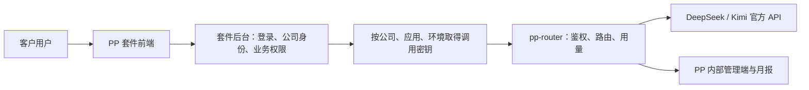

# PP 套件接入指南

[返回项目首页](../README.md) · [环境与地址](environments.md) · [API 参考](api-reference.md) · [可运行示例](examples/README.md)

面向负责 PP 其他产品、需要调用 pp-router 的研发人员。你不需要修改或部署网关；通常只需取得目标公司应用的密钥，调整服务端调用地址，并把租户映射接好。

## 1. 接入后的职责分工



| 套件负责 | pp-router 负责 |
|---|---|
| 终端用户登录、会话和公司成员权限 | 校验公司应用密钥及授权状态 |
| 根据已认证用户确定真实公司 | 从密钥确定公司、应用和环境 |
| 管理会话消息、业务附件、业务结果 | 转发符合能力约束的模型请求 |
| 验证并执行工具函数 | 传递工具调用，绑定工具续接的模型与模式 |
| 保存公司 ID 与密钥的服务端映射 | 持久化用量、路由结果、状态和诊断信息 |

**调用应来自套件后台。** 不把密钥放进浏览器、小程序、移动客户端或前端构建环境变量。当前没有可下发给终端用户的短期、低权限模型令牌机制。即使客户自有系统直接接入，也应由客户服务端保管分配给该客户的应用密钥。

## 2. 开始前向网关负责人取得什么

1. 目标环境的 OpenAI SDK `base_url`，见 [地址表](environments.md)。
2. 已登记的应用及 `application_id`，例如一个客服套件共用一个应用目录条目；不要为每个客户重复创建同名应用。
3. 客户在 PP 内部统一的公司标识，以及网关 `company_id` 的映射。
4. 该公司已开通此应用的 `grant_id`，模型权限、RPM、并发和输出上限。
5. 对应环境的应用密钥，通常以 `ppk_` 开头；同时记录非敏感的 `key_id`、有效期和负责人。

同一个客户在多个 PP 套件中，应尽量使用统一的客户主数据 ID 对应同一家公司，再分别开通各应用。`external_id` 在网关内全局唯一，不能直接使用会在不同套件间撞号的局部数字。尚未统一 ID 时，先与 PP 平台确认映射规则。

`pp_admin` 是内部演示公司；正式客户流量应使用各自公司的授权和密钥。也不要拿 `pp_admin` 管理员密码、`ppi_` 内部开户凭证或上游供应商 API Key 调用模型。

## 3. 五分钟完成第一次调用

以下环境变量由你的服务端配置或密钥管理方式提供。`PP_ROUTER_API_KEY` 是**网关应用密钥**，不是 `DEEPSEEK_API_KEY` / `MOONSHOT_API_KEY`。

```sh
export PP_ROUTER_BASE_URL='https://150.158.155.100/v1'
# 在服务端私密环境中配置 PP_ROUTER_API_KEY，勿提交到 Git。
```

先列模型。这一步不调用供应商模型，不消耗模型 token：

```sh
curl --fail-with-body --silent --show-error \
  "$PP_ROUTER_BASE_URL/models" \
  -H "Authorization: Bearer $PP_ROUTER_API_KEY"
```

成功时响应包含当前密钥可访问、已启用且供应商已配置的模型；有可用模型时加入 `auto`。它不是对某个具体请求的能力承诺：例如模型列表里有 `deepseek-v4-pro`，也不代表它可以处理图片。

最小 Python 示例（需要 `openai` 包）：

```python
import os
from openai import OpenAI

client = OpenAI(
    api_key=os.environ["PP_ROUTER_API_KEY"],
    base_url=os.environ["PP_ROUTER_BASE_URL"],
    max_retries=0,
    timeout=210.0,
)
try:
    raw = client.chat.completions.with_raw_response.create(
        model="deepseek-flash",
        messages=[{"role": "user", "content": "只回复 OK。"}],
        max_tokens=32,
        extra_headers={"X-Trace-ID": "suite-demo-001"},
    )
    answer = raw.parse()
    print(answer.choices[0].message.content)
    print("request_id:", raw.headers.get("x-request-id"))
    print("usage:", answer.usage)
finally:
    client.close()
```

这个例子会产生一次真实上游调用。`timeout=210` 只是客户端示例值，不会改变服务端超时或保证长请求一定完成。初次联调先用短输入和低输出上限，确认归属与统计，再测试长任务。

Node.js 服务端可直接使用标准 HTTP 接口，见 [Node 示例](examples/chat.mjs)；Python 文本、流式、图片、JSON 和完整工具往返见 [Python 示例](examples/client.py)。示例每次只运行一个明确选择的场景，没有默认“全量真实测试”。

## 4. 多公司身份必须在套件后台确定

套件后台应维护类似下面的映射；实际密钥放在受保护存储中：

| 业务侧标识 | 网关记录 | 密钥归属 |
|---|---|---|
| PP 客户 A | `company_id=A` | A / 客服应用 / production |
| PP 客户 B | `company_id=B` | B / 客服应用 / production |
| PP 客户 A 的测试环境 | 同一个 `company_id=A` | A / 客服应用 / staging |

收到用户请求后，从套件登录态和业务权限确定公司，读取该公司对应密钥，再调用网关。不要直接采用浏览器提交的 `company_id` 来选择密钥。

模型请求体中传 `company_id`、`application_id` 或其他未知字段会被拒绝；自定义身份头也不能改变密钥归属。`user` 只能作为可选的匿名化用户标识，不能替代公司鉴权；网关只记录其公司范围内的哈希。

同一公司应用授权下的所有密钥，**包括不同 environment 标签的密钥，共享该授权的模型权限、RPM 和并发限制**。拆分密钥不会增加额度。环境标签用于报表和工具续接隔离，不会把请求发往另一台网关。

## 5. 如何开通客户

### 方式 A：由 PP 管理员开通

管理员在“公司与接入”中创建公司、开通应用、配置授权、签发环境密钥，再通过内部安全渠道交给套件后台负责人。适合初次接入和少量客户。运营流程见 [运营与销售指南](operations.md)。

### 方式 B：受信任的套件开户后台自动开通

内部开户 API 使用独立 `Authorization: Bearer <内部开户凭证>`。**目前这种凭证没有按某家公司或应用细分权限**，只能交给可信的 PP 后台，建议集中在开户服务中；不能分发给客户或终端用户。

先由平台管理员登记应用并提供 `application_id`。内部 API 目前没有应用目录创建或列表接口，不需要为了开户而把管理员账号放进套件代码。

步骤及请求字段见 [API 参考](api-reference.md)。完整业务顺序为：

1. `POST /internal/v1/companies`，提交公司代码、名称和统一 `external_id`。保存返回的网关 `id`。
2. `POST /internal/v1/grants`，提交 `company_id`、平台提供的 `application_id` 和明确的授权配置。保存返回的授权 `id`。
3. `POST /internal/v1/keys`，提交 `grant_id`、名称、环境和可选有效期。把返回的 `secret` 直接写入受保护存储，保存 `id` 供后续撤销。
4. 用新密钥调用 `/v1/models`；必要时做一次短文本联调，由管理员确认公司、应用、环境和 token 归属。
5. 客户使用套件自己的登录入口。公司开户过程不创建 pp-router 客户密码。

| 重复请求 | 当前行为 |
|---|---|
| 相同 `external_id` 的公司开户 | 返回已有公司，不修改其名称、代码或启停状态 |
| 相同公司 + 应用的开通 | 返回已有授权，不覆盖配置或重新启用 |
| 重复签发密钥 | **每次生成一把新密钥，不幂等** |
| 用同一 `X-Trace-ID` 重复调用模型 | 仍是新请求，可能再次产生用量，不去重 |

开户结果必须持久化。发放密钥遇到网络中断时，不要盲目反复签发；请管理员核对该次签发记录和多余凭证。公司或授权已停用时，需要对应的启用 / 更新接口；重复 POST 不会恢复它们。

## 6. 显式模型与 `auto`

显式模型适合已完成评测、需要固定行为的功能。`auto` 会先按授权、凭证、图片、工具、输出格式、模式和上下文过滤模型，再在多个候选间使用语义分类。

- 没有合格模型会明确报错，不会删掉图片、工具或 Schema 要求继续执行。
- 只有一个候选时直接执行。严格 JSON Schema 当前通常只剩 Kimi，因此无需分类调用。
- 多候选时默认用 DeepSeek Flash 分类；分类器同样必须在授权范围内。
- 分类失败或分类器不可用，会使用合格的默认候选，并记录降级原因。
- 显式模型不会自动换成另一个模型；`auto` 执行 fallback 也必须保持能力和权限约束。

`auto` 不意味着“始终最便宜”“始终最佳”或“模型行为固定”。当前不维护价格表，路由偏好是可配置的策略。模型能力和参数组合见 [API 参考](api-reference.md)。

对于数据处理要求严格的客户，需要知道：`auto` 分类可能先把任务文字和最近文字上下文发送给 DeepSeek，再由另一家供应商完成业务请求。分类器不接收图片正文和图片 URL；最终执行模型会收到原始业务消息中的图片。若客户只允许某一供应商，应在授权层限制模型，并与网关负责人确认路由设置。

## 7. 图片、JSON、流式和工具接入要点

**图片。** 通过 `messages[].content` 数组传 `text` 与 `image_url`。支持 HTTPS URL，以及 PNG / JPEG / WebP / GIF 的 Base64 data URL。最多 8 张，单张内联图片解码后最多 5 MiB，请求体最多 20 MiB（Base64 会增加请求体体积）。URL 必须能被供应商访问；网关不下载远程图片，也不替你传浏览器 Cookie 或登录凭证。供应商仍可能拒绝不支持的文件内容或图像规格。

**JSON。** `json_object` 和严格 `json_schema` 不是同一件事。后者在当前模型目录中仅 Kimi 支持；需要严格 Schema 时显式声明 `response_format`，让程序据此过滤。业务侧仍需检查响应是否被截断及 JSON 是否符合自己的要求。

**流式。** 使用 `stream=true`，需要尾部 usage 时传 `stream_options={"include_usage": true}`。逐块处理 `choices`，允许 usage chunk 的 `choices` 为空；只把 `delta.content` 作为回答文字，不把 `reasoning_content` 拼进最终回答。消费到正常结束，异常或缺少 `[DONE]` 不能只凭 HTTP 200 判断成功。客户端取消时主动关闭流，避免后台继续等待。完整示例见 [client.py](examples/client.py)。

OpenAI SDK 不向业务代码暴露原始 `[DONE]` 标记；Python 示例额外检查 `finish_reason`，并展示用量是否缺失。如果业务需要严格核验这个尾标记，应在原始 SSE 消费层检查，不能只看 SDK 循环已经退出。

**工具。** 工具执行属于套件应用，网关不会替你执行数据库查询、下单或其他函数。对工具名称、参数和业务权限再次校验。返回工具结果时，应保留完整 assistant 消息，包括 `tool_calls`、ID 和必要的 `reasoning_content` 扩展字段；然后追加对应的 `role=tool` 消息。

工具续接的最后几条消息应是对应的工具结果；使用同一公司应用和环境。网关根据 `tool_call_id` 绑定第一次实际执行的模型及推理模式；绑定存在时，`auto` 续接不会重新分类。换了环境、丢失绑定或迁移到另一套数据库时，`auto` 可能返回 `unknown_tool_binding`，此时应显式指定原模型并保持原模式，不能让应用随意换模型续接。

## 8. 用量、追踪与重试

- 保存响应 `X-Request-ID`，并为业务链路设置 `X-Trace-ID`。trace 只用于关联日志，不提供幂等语义。
- 标准响应的 `usage` 仅对应最终执行调用；分类和重试用量需要从管理员报表核对。
- 一次 `auto` 可能是 1 个业务请求、2 次上游调用。不要用客户侧 response.usage 之和直接代替全平台用量。
- 图片、缓存、推理明细是上游提供的子项，不能再次加到 total 中；缺失 usage 记为未知，不等于零。
- 月份按受理时间归属 `Asia/Shanghai`，跨月完成不会改归属月。

示例关闭了 SDK 自动重试。网关自身最多增加一次明确可安全进行的执行重试；未知结果的超时和已输出内容的流式失败不会自动重放。客户端如果再重试，会产生新的请求及潜在用量。对 429 可结合 `Retry-After`、业务幂等和自己的预算判断是否稍后重试；对超时或部分输出，先记录请求 ID，不要无条件叠加多层重试。

请求记录、月报和 CSV 目前只供内部管理员查看。没有面向客户或普通应用密钥开放的用量查询 API；套件若需客户自助看用量，需要另行设计交付方式。

## 9. 密钥更新与故障定位

密钥只在签发 / 轮换时显示一次。需要平滑切换时，可以先为相同授权和环境签发新密钥，更新套件服务，验证后撤销旧密钥。管理端“轮换”会**立即撤销旧密钥**，没有双钥并存宽限期，并保留原有效期；已过期密钥需要重新签发合适有效期的新密钥。

| 现象 | 先检查 |
|---|---|
| 401 | 是否使用了应用密钥；目标环境是否正确；密钥是否撤销 / 过期 |
| 403 `access_disabled` | 公司、应用目录或该公司应用授权是否被停用 |
| 400 `model_unavailable` / `no_eligible_model` | 模型权限、供应商配置、图片 / Schema / 模式以及输出上限 |
| 429 | 同公司应用的其他密钥和环境是否共用了 RPM / 并发；也可能是上游限流 |
| 502 / 504 | 保存 request ID，由网关维护者排查供应商或连接问题；不要自动循环重试 |
| 收到 HTML 而不是 JSON | URL 是否误用了管理端路径；是否触发代理层错误 |
| 成功但月报少了 token | 是否只看了响应 usage；是否筛错月份 / 环境；是否有未知用量 |

提交排障信息时提供：环境、公司与应用、密钥前缀或 ID、请求 ID、trace ID、时间、状态码和错误代码。不要发送完整密钥、用户会话 Cookie、图片或完整敏感对话。错误详情和接口约束见 [API 参考](api-reference.md)。

## 10. 接入交付核对

- 公司主数据映射正确，客户 A 的会话不能选择客户 B 的密钥。
- 正式流量使用该客户的公司应用密钥；staging / production 已明确标记。
- 模型目录、普通请求和需要的图片 / JSON / 工具功能通过验证。
- 流式客户端能处理空 choices、usage、错误和主动取消。
- 客户端超时、重试、工具权限和输出上限由套件显式控制。
- 管理员能按公司、应用、环境查到请求，分类与执行 token 可解释。
- 密钥保存、轮换、撤销及故障联系人已经交接。
