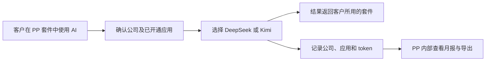

# 运营与销售指南

[返回项目首页](../README.md) · [后台地址与账号获取](environments.md) · [交给研发的接入指南](integration.md)

本页面向 PP 内部运营、销售和客户成功人员，不要求会写代码。

## 这套系统解决什么问题

pp-router 是 PP 各产品套件共用的 AI 调用服务。客户在套件中使用问答、图片理解、生成内容等功能时，套件后台把请求交给 pp-router；网关检查这家公司是否开通了该应用，选择可用模型，返回结果并记录用量。



它主要帮助我们回答：**哪家公司在什么应用里用了哪些模型，用了多少 token，哪些请求成功或失败。**

当前支持 DeepSeek 和 Kimi 官方模型，可以处理文字、图片，以及应用开发者配置的工具调用和 JSON 结果。具体功能还取决于客户所用套件本身是否已经实现，网关支持不等于每个套件都自动有该功能。

共享应用目录为 **PP Code、PP Chat、PP CAD**，三个应用均可使用全部模型。应用用来区分产品和用量，不是把编程限定到某个模型、把图片限定到某个应用。早期“工具调用 / 普通对话 / 图片理解”分别更名为这三个产品，详见 [应用目录与迁移说明](applications.md)。

## 六个容易混淆的词

| 名词 | 可以这样理解 |
|---|---|
| 公司 | 一家客户的独立用量归属，例如“甲公司” |
| 应用 | 某个产品套件，例如 PP Chat；同一个应用可以开给多家公司 |
| 应用授权 | “允许甲公司使用 PP Chat”，并规定模型范围和调用限制 |
| 调用密钥 | 套件后台访问网关的通行凭证，绑定公司、应用和环境；不是客户登录密码 |
| 模型 | 实际完成任务的 AI 服务；客户可由套件指定，也可使用 auto |
| token | 模型处理文字、图片和生成结果时的计量单位；不是人民币，也不能简单当作汉字数 |

`pp_admin` 有两种独立身份：一个是初始平台管理员账号，另一个是内部演示公司。演示公司调用模型时照常受限制、照常计用量；公司叫这个名字不会获得管理权限。

| 身份 | 能使用什么入口 |
|---|---|
| `pp_admin` 平台管理员 | 登录 pp-router 管理端，管理全部公司、应用及用量 |
| `pp_admin` 公司及其应用密钥 | 调用模型、记录内部用量；应用密钥不能登录管理端 |
| 新创建的客户公司 | 需要另行开通应用并交付套件使用方式；没有自动生成的管理端账号 |

初始化同时建立了两个 `pp_admin` 实体，因此看起来“同名公司也能登录”。真正登录的是管理员账号，其他公司不因此获得登录权限。停用 `pp_admin` 公司只影响该公司的模型调用，不会停用管理员登录。

## 客户应该如何“注册”和使用

**目前没有客户自助注册页，也没有客户登录 pp-router 后台的账号体系。** 这里的“开户”，是 PP 为客户建立公司记录、开通应用和配置调用权限。

按客户使用入口区分：

| 客户情况 | 客户做什么 | PP 做什么 |
|---|---|---|
| 使用 PP Code | 提供公司信息，在 PP Code 的 Sign in 中输入管理员交付的应用邀请码 | 开通客户的 PP Code 授权、签发密钥；邀请码由 PP Code 本地后端验证和保存 |
| 使用其他 PP 套件 | 按该套件提供的入口和身份方式使用 AI 功能 | 关联公司、开通应用，由套件后台保管调用密钥；不把网关开户当作套件已上线 |
| 客户有自己的系统，需要直接接入 | 由客户研发完成服务端集成 | 创建正确的公司应用授权，向指定技术负责人交付该客户的应用密钥与接入文档 |

交付 PP Code 时，可把其真实仓库中的 [用户指南](https://github.com/Principle-of-Procrastination/pp-code/blob/main/pp/WEB.md)作为安装、启动、邀请码录入和更新的操作说明；技术同事可从 [PP Code 仓库](https://github.com/Principle-of-Procrastination/pp-code)查阅实现与发布资料。

客户不需要拿到 PP 的供应商 API Key、内部开户凭证或 `pp_admin` 管理员密码。合同、采购、收款和套件用户注册仍走 PP 现有业务流程，pp-router 不办理下单和支付。

客户规模扩大后，可信的 PP 后台也可以通过内部接口自动开户；是否采用自动化由研发安排，不改变客户的使用入口。

## 开户前收集的信息

销售 / 运营可以把下面这张表交给负责开户的内部管理员：

| 信息 | 示例 / 说明 |
|---|---|
| 客户公司名称 | 甲公司 |
| PP 统一客户 ID | 从 PP 客户主数据或套件后台确认，避免同一客户重复建公司 |
| 需要开通的套件 / 应用 | PP Code、PP Chat、PP CAD；使用已有应用目录名称 |
| 使用环境 | 联调、测试还是正式使用 |
| 需要的能力 | 文字、图片、工具或结构化输出，由套件研发确认 |
| 模型要求 | 是否只能使用某家供应商；不要仅凭模型名称自行承诺能力 |
| 预期使用量 / 使用高峰 | 供研发设置每分钟请求数、并发和单次输出上限 |
| 有效期与交付负责人 | 技术联系人、开通时间和后续支持人 |

公司代码和应用代码由内部统一管理，避免重名。一个客户要使用第二个套件时，通常是在已有公司下新增应用授权，不需要再建一家公司。

## 管理员手动开户步骤

只有获得平台管理员权限的人操作以下步骤。当前后台没有独立的销售只读角色；没有权限的同事提交开户申请或向管理员索取所需报表即可。

1. 打开 [管理端](environments.md)，使用内部管理员账号。登录表单当前的提交按钮显示为“保存”。
2. 进入“**公司与接入**”，先查找客户是否已经存在。确认不存在后点击“**公司开户**”，填写公司名称、代码及套件侧公司 ID。
3. 在该公司行点击“**开通应用**”，选择已确认的应用。如果目录里没有这个应用，由套件负责人确认后通过“新增应用”登记；不要把公司名称当成新的应用。
4. 在“**应用授权与限制**”中找到“客户 / 应用”，点击“**配置**”。由技术同事确认允许的模型、每分钟请求数、并发和输出上限。路由策略由负责该套件的研发维护。
5. 点击“**签发凭证**”，在“绑定应用”中明确选择该客户和应用，填写名称、环境及可选过期时间。**给客户应用发钥时，不要选择默认列表中的“内部开户凭证”。**
6. 新密钥只显示一次。通过内部指定的安全方式交给套件后台负责人，或经确认的客户技术负责人；不要放进群公告、工单公开描述或普通产品截图。
7. 研发将密钥配置到后台。管理员在“**调用与调试**”选择正确的公司应用身份，做一次短输入测试，再到“**总览与月报**”确认归属和用量。
8. 向客户确认其使用入口、已开通能力和支持方式。PP Code 用户收到本公司该应用的邀请码和录入说明，其他套件按各自入口交付；直接 API 客户另附 [接入指南](integration.md)。不要把团队共享管理员密码当成客户账号发放。

开户不会自动生成客户密码，也不会自动邀请客户员工。重复点击“开通应用”只返回已有授权，不会恢复停用状态或修改旧设置；需要到授权配置中更新。

## 如何理解自动选模型

“显式模型”就是由应用固定选择一个模型。“auto”会先确认哪些模型有权限且能满足任务，再在需要时用一个小分类调用判断路线；分类失败时可能采用合格的默认路线。

它不会为了完成请求而跳过客户权限，也不会把图片或严格输出格式要求丢掉。没有合格模型就会报错，需要调整授权或功能要求。

对客户可以说：“我们支持在已授权、可满足任务的模型中自动选择路线，并保留选路和用量记录。”不要承诺每次都是最低价格、最高质量或固定时延。当前系统没有价格表；已完成的语义评测结果也只适用于当时的测试集。

如果客户限定数据只能由某家供应商处理，要让技术人员配置模型授权。开启 auto 时，分类任务可能把文字先交给 DeepSeek，最终回答再交给 Kimi；不能只看最终回答模型就承诺只经过一家供应商。

## 月报怎么读

进入“**总览与月报**”，选择月份，再按公司、应用、环境、密钥、供应商、实际模型和阶段筛选，使用“**导出 CSV**”取得当前筛选结果。给客户准备材料时务必确认公司筛选正确。

| 指标 | 含义 |
|---|---|
| 业务请求 | 应用提交到网关、被记录的一次请求 |
| 上游调用 | 网关实际向模型供应商发出的调用，包括分类和执行尝试 |
| 输入 / 输出 token | 上游确认的输入和生成结果消耗 |
| 路由开销 | 为 auto 选模型而进行的分类消耗 |
| 未知用量 | 上游没有返回足够有效 usage 的调用数；不等于零消耗 |
| 成功率 | 当前报表范围内业务请求成功的比例，不能等同于客户整套业务的成功率 |

例如，一个问题先用 DeepSeek 分类，再用 Kimi 回答：**业务请求是 1，上游调用是 2，两家模型的 token 分别统计。** 有重试时调用数还会增加。研发使用只选路预览进行评测时，也会形成请求和分类用量；演示、调试并不是免费调用。

月报按请求**开始受理时**的上海时间归月。10 月 31 日 23:59 受理、11 月 1 日完成的请求仍属于 10 月。缓存、推理、图片等明细若已包含在输入或输出中，不要再次相加。

看分组数据时，不要把每个模型行的“业务请求数”直接相加：同一次请求可能同时出现在分类模型和回答模型的行里。全局去重总数以页面汇总为准。

遇到未知用量，应保留该标记并请技术核查；不能把已确认 token 包装成完整供应商账单。没有收到模型正文、调用失败、客户取消，也不保证没有上游消耗。

### 月度交付建议

1. 确认客户公司、月份、正式环境以及是否包含联调 / 演示流量。
2. 查看业务请求数、确认 token、路由开销和未知用量。
3. 如有异常，先请技术根据请求 ID 核查，再解释原因。
4. 按当前筛选导出 CSV，记录导出时间与筛选条件。
5. 如商务上需要金额结算，按 PP 另行约定的价格和财务流程处理；平台本身没有金额计算、自动封账或收款功能。

## 暂停、到期和密钥更新

| 操作 | 影响范围 |
|---|---|
| 停用某家公司 | 该公司所有应用的新调用 |
| 停用某公司的一项应用授权 | 仅该公司该应用的新调用 |
| 停用“应用目录”中的应用 | **所有公司**对该应用的新调用 |
| 停用某个模型 | 全平台后续请求不能使用该模型 |
| 撤销一把调用密钥 | 使用这把密钥的新调用；其他密钥不受直接影响 |
| 密钥到期 | 该密钥无法继续调用，需要交接新密钥 |

这些操作不删除历史用量，也不保证中止已经开始的请求。暂停一个客户时，不要误点全局应用或全局模型的停用按钮。

“轮换”会立即撤销旧密钥并生成新密钥，而且保留原来的到期时间。需要不中断服务的切换时，由研发安排“先签发新钥 → 更新后台 → 验证 → 撤销旧钥”。已过期的密钥应重新签发，不把轮换当作续期。

每分钟请求数、并发、输出上限是技术保护，不是月度 token 套餐或金额余额。同一公司应用下的多个密钥共享这些限制；系统不会因为达到销售合同中的月度金额而自动停机。

当前三个产品统一默认输出上限 32000、总上下文上限 256000。总上下文包含输入和输出，并非每次必须消耗这么多 token；实际消耗以用量记录为准。内容过长时，套件需要缩短内容或整理历史后再发起请求。

## 客户常见问答

**能自己注册 pp-router 并登录查看用量吗？** 当前不能。由 PP 开户，客户使用对应套件入口；PP Code 当前使用应用邀请码。用量由内部管理员查询和导出，客户自助门户需要后续建设。

**公司开户后，所有 PP 应用都能用吗？** 不能。按公司逐项授权应用；当前三个产品均开通全部模型，密钥、用量和调用限制按公司应用分别管理。客户有供应商限制等特殊要求时，由技术人员单独配置。

**客户需要自己买 DeepSeek / Kimi 密钥吗？** 当前通过 PP 网关统一配置供应商凭证。普通客户使用的是自己的公司应用调用权限；暂不支持客户自带供应商 Key。

**月报能直接作为金额账单吗？** 不能。现在只有确认 token 用量，未配置售价、优惠、税费、金额结算或支付功能。

**提示“未配置”或调用失败，客户应该重新注册吗？** 不应该。先由内部技术人员区分供应商配置、权限、密钥到期、限流或服务故障，重复开户通常无法解决。

**系统会保存客户的对话和图片吗？** 网关默认不保存 prompt、回答、推理正文或图片，只保存必要的用量与诊断记录；套件自身和供应商的数据处理方式需要分别确认。请求内容会发送给实际参与处理的供应商，不能把“网关不保存正文”解释为“数据不发送给外部服务”。

**能否承诺无限调用或任何时间都不中断？** 当前有调用限制，部署也仍是单机 MVP。具体服务保障需要单独评估与约定，不能根据已有管理页面推导出高可用或无限容量。

## 交接与报障模板

```text
客户公司 / PP 客户 ID：
需要开通或排查的应用：
环境（测试 / 正式）：
客户技术联系人 / PP 套件负责人：
问题发生时间（注明时区）：
请求 ID / trace ID（如有）：
页面错误代码或不含敏感内容的截图：
希望完成的事项与期望时间：
```

不附完整密钥、管理员密码或敏感对话。业务归属和开通范围由销售 / 运营确认，后台操作由授权管理员完成，调用和供应商问题交由套件研发及网关维护者处理。
